<!-- Every image here is drawn by scripts/readme.mjs. Edit the content there, then run: node scripts/readme.mjs build -->

<picture><source media="(prefers-color-scheme: dark)" srcset="https://raw.githubusercontent.com/pksingh1508/pksingh1508/main/assets/dark/hero.svg"><source media="(prefers-color-scheme: light)" srcset="https://raw.githubusercontent.com/pksingh1508/pksingh1508/main/assets/light/hero.svg"></picture>

<a href="https://linkedin.com/in/pawan-kumar-731ab3239/"><picture><source media="(prefers-color-scheme: dark)" srcset="https://raw.githubusercontent.com/pksingh1508/pksingh1508/main/assets/dark/link-linkedin.svg"><source media="(prefers-color-scheme: light)" srcset="https://raw.githubusercontent.com/pksingh1508/pksingh1508/main/assets/light/link-linkedin.svg"></picture></a>&nbsp;&nbsp;<a href="https://github.com/pksingh1508?tab=repositories"><picture><source media="(prefers-color-scheme: dark)" srcset="https://raw.githubusercontent.com/pksingh1508/pksingh1508/main/assets/dark/link-github.svg"><source media="(prefers-color-scheme: light)" srcset="https://raw.githubusercontent.com/pksingh1508/pksingh1508/main/assets/light/link-github.svg"></picture></a>&nbsp;&nbsp;<a href="https://instagram.com/pksingh1508"><picture><source media="(prefers-color-scheme: dark)" srcset="https://raw.githubusercontent.com/pksingh1508/pksingh1508/main/assets/dark/link-instagram.svg"><source media="(prefers-color-scheme: light)" srcset="https://raw.githubusercontent.com/pksingh1508/pksingh1508/main/assets/light/link-instagram.svg"></picture></a>

 

<picture><source media="(prefers-color-scheme: dark)" srcset="https://raw.githubusercontent.com/pksingh1508/pksingh1508/main/assets/dark/title-about.svg"><source media="(prefers-color-scheme: light)" srcset="https://raw.githubusercontent.com/pksingh1508/pksingh1508/main/assets/light/title-about.svg"></picture>

<picture><source media="(prefers-color-scheme: dark)" srcset="https://raw.githubusercontent.com/pksingh1508/pksingh1508/main/assets/dark/about.svg"><source media="(prefers-color-scheme: light)" srcset="https://raw.githubusercontent.com/pksingh1508/pksingh1508/main/assets/light/about.svg"></picture>

 

<picture><source media="(prefers-color-scheme: dark)" srcset="https://raw.githubusercontent.com/pksingh1508/pksingh1508/main/assets/dark/title-work.svg"><source media="(prefers-color-scheme: light)" srcset="https://raw.githubusercontent.com/pksingh1508/pksingh1508/main/assets/light/title-work.svg"></picture>

<a href="https://github.com/pksingh1508/eu_work_support_app"><picture><source media="(prefers-color-scheme: dark)" srcset="https://raw.githubusercontent.com/pksingh1508/pksingh1508/main/assets/dark/work-eu-work-support.svg"><source media="(prefers-color-scheme: light)" srcset="https://raw.githubusercontent.com/pksingh1508/pksingh1508/main/assets/light/work-eu-work-support.svg"></picture></a>
<a href="https://github.com/pksingh1508/eu-crm-service"><picture><source media="(prefers-color-scheme: dark)" srcset="https://raw.githubusercontent.com/pksingh1508/pksingh1508/main/assets/dark/work-eu-crm.svg"><source media="(prefers-color-scheme: light)" srcset="https://raw.githubusercontent.com/pksingh1508/pksingh1508/main/assets/light/work-eu-crm.svg"></picture></a>
<a href="https://github.com/pksingh1508/signflow"><picture><source media="(prefers-color-scheme: dark)" srcset="https://raw.githubusercontent.com/pksingh1508/pksingh1508/main/assets/dark/work-signflow.svg"><source media="(prefers-color-scheme: light)" srcset="https://raw.githubusercontent.com/pksingh1508/pksingh1508/main/assets/light/work-signflow.svg"></picture></a>
<a href="https://github.com/pksingh1508/crossnation"><picture><source media="(prefers-color-scheme: dark)" srcset="https://raw.githubusercontent.com/pksingh1508/pksingh1508/main/assets/dark/work-eu-career-serwis.svg"><source media="(prefers-color-scheme: light)" srcset="https://raw.githubusercontent.com/pksingh1508/pksingh1508/main/assets/light/work-eu-career-serwis.svg"></picture></a>
<a href="https://github.com/pksingh1508/scanlabel"><picture><source media="(prefers-color-scheme: dark)" srcset="https://raw.githubusercontent.com/pksingh1508/pksingh1508/main/assets/dark/work-scanlabel.svg"><source media="(prefers-color-scheme: light)" srcset="https://raw.githubusercontent.com/pksingh1508/pksingh1508/main/assets/light/work-scanlabel.svg"></picture></a>
<a href="https://github.com/pksingh1508/desi_runner"><picture><source media="(prefers-color-scheme: dark)" srcset="https://raw.githubusercontent.com/pksingh1508/pksingh1508/main/assets/dark/work-desi-run.svg"><source media="(prefers-color-scheme: light)" srcset="https://raw.githubusercontent.com/pksingh1508/pksingh1508/main/assets/light/work-desi-run.svg"></picture></a>

More projects

 

[EU Strapi CMS](https://github.com/pksingh1508/eu-strapi-cms) · [EU Invoice](https://github.com/pksingh1508/eu-invoice) · [EU Work Support Web](https://github.com/pksingh1508/eu_work_support_web) · [All repositories →](https://github.com/pksingh1508?tab=repositories)

 

<picture><source media="(prefers-color-scheme: dark)" srcset="https://raw.githubusercontent.com/pksingh1508/pksingh1508/main/assets/dark/title-stack.svg"><source media="(prefers-color-scheme: light)" srcset="https://raw.githubusercontent.com/pksingh1508/pksingh1508/main/assets/light/title-stack.svg"></picture>

<picture><source media="(prefers-color-scheme: dark)" srcset="https://raw.githubusercontent.com/pksingh1508/pksingh1508/main/assets/dark/stack.svg"><source media="(prefers-color-scheme: light)" srcset="https://raw.githubusercontent.com/pksingh1508/pksingh1508/main/assets/light/stack.svg"></picture>

 

<picture><source media="(prefers-color-scheme: dark)" srcset="https://raw.githubusercontent.com/pksingh1508/pksingh1508/main/assets/dark/title-ship.svg"><source media="(prefers-color-scheme: light)" srcset="https://raw.githubusercontent.com/pksingh1508/pksingh1508/main/assets/light/title-ship.svg"></picture>

<picture><source media="(prefers-color-scheme: dark)" srcset="https://raw.githubusercontent.com/pksingh1508/pksingh1508/main/assets/dark/ship-console.svg?v=1.1.0"><source media="(prefers-color-scheme: light)" srcset="https://raw.githubusercontent.com/pksingh1508/pksingh1508/main/assets/light/ship-console.svg?v=1.1.0"></picture>

<a href="https://github.com/pksingh1508/pksingh1508/issues/new?title=ship+--feature&body=Press+%22Create%22+to+ship+this+release.+A+GitHub+Action+will+build%2C+test%2C+and+deploy+it+to+the+profile+in+about+a+minute."><picture><source media="(prefers-color-scheme: dark)" srcset="https://raw.githubusercontent.com/pksingh1508/pksingh1508/main/assets/dark/btn-feature.svg"><source media="(prefers-color-scheme: light)" srcset="https://raw.githubusercontent.com/pksingh1508/pksingh1508/main/assets/light/btn-feature.svg"></picture></a>&nbsp;<a href="https://github.com/pksingh1508/pksingh1508/issues/new?title=ship+--fix&body=Press+%22Create%22+to+ship+this+release.+A+GitHub+Action+will+build%2C+test%2C+and+deploy+it+to+the+profile+in+about+a+minute."><picture><source media="(prefers-color-scheme: dark)" srcset="https://raw.githubusercontent.com/pksingh1508/pksingh1508/main/assets/dark/btn-fix.svg"><source media="(prefers-color-scheme: light)" srcset="https://raw.githubusercontent.com/pksingh1508/pksingh1508/main/assets/light/btn-fix.svg"></picture></a>&nbsp;<a href="https://github.com/pksingh1508/pksingh1508/issues/new?title=ship+--hotfix&body=Press+%22Create%22+to+ship+this+release.+A+GitHub+Action+will+build%2C+test%2C+and+deploy+it+to+the+profile+in+about+a+minute."><picture><source media="(prefers-color-scheme: dark)" srcset="https://raw.githubusercontent.com/pksingh1508/pksingh1508/main/assets/dark/btn-hotfix.svg"><source media="(prefers-color-scheme: light)" srcset="https://raw.githubusercontent.com/pksingh1508/pksingh1508/main/assets/light/btn-hotfix.svg"></picture></a>&nbsp;<a href="https://github.com/pksingh1508/pksingh1508/issues/new?title=ship+--friday-deploy&body=Press+%22Create%22+to+ship+this+release.+A+GitHub+Action+will+build%2C+test%2C+and+deploy+it+to+the+profile+in+about+a+minute."><picture><source media="(prefers-color-scheme: dark)" srcset="https://raw.githubusercontent.com/pksingh1508/pksingh1508/main/assets/dark/btn-friday-deploy.svg"><source media="(prefers-color-scheme: light)" srcset="https://raw.githubusercontent.com/pksingh1508/pksingh1508/main/assets/light/btn-friday-deploy.svg"></picture></a>

 

<picture><source media="(prefers-color-scheme: dark)" srcset="https://raw.githubusercontent.com/pksingh1508/pksingh1508/main/assets/dark/title-activity.svg"><source media="(prefers-color-scheme: light)" srcset="https://raw.githubusercontent.com/pksingh1508/pksingh1508/main/assets/light/title-activity.svg"></picture>

<picture><source media="(prefers-color-scheme: dark)" srcset="https://raw.githubusercontent.com/pksingh1508/pksingh1508/main/assets/dark/activity.svg"><source media="(prefers-color-scheme: light)" srcset="https://raw.githubusercontent.com/pksingh1508/pksingh1508/main/assets/light/activity.svg"></picture>

 

<picture><source media="(prefers-color-scheme: dark)" srcset="https://raw.githubusercontent.com/pksingh1508/pksingh1508/main/assets/dark/footer.svg?v=1.1.0"><source media="(prefers-color-scheme: light)" srcset="https://raw.githubusercontent.com/pksingh1508/pksingh1508/main/assets/light/footer.svg?v=1.1.0"></picture>
