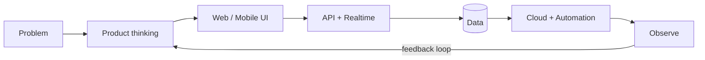

<!-- ────────────────────────────────────────────────────────────────
     PAWAN KUMAR · ENGINEERING CONTROL ROOM
     Built to be useful, fast to scan, and hard to forget.
──────────────────────────────────────────────────────────────── -->

<div align="center">


[](https://git.io/typing-svg)

[](https://linkedin.com/in/pawan-kumar-731ab3239/)
[](https://github.com/pksingh1508)
[](https://instagram.com/pksingh1508)

<p align="center">  </p>

</div>

## `~/mission-control`

```text
┌─ PAWAN@ENGINEERING
│
├─ role       Software Development Engineer
├─ coordinates Gorakhpur, India
├─ current    production systems · call operations · full-stack products
├─ building   mobile-first experiences that survive real-world usage
├─ exploring  DevOps · distributed systems · AI-assisted engineering
└─ principle  ship → measure → learn → improve ↻
```

I build software where polished interfaces meet dependable systems. My favorite work lives across the whole delivery path—from the first component and API contract to database performance, automation, deployment, and the feedback loop after release.

> **Current signal:** turning operational pain into maintainable software, one measurable improvement at a time.

## `~/system-map`



## `~/toolbox`

<div align="center">

### Languages · Runtime · Frameworks

[](https://skillicons.dev)

### Data · Delivery · Infrastructure

[](https://skillicons.dev)


</div>

## `~/engineering-radar`

| What I care about | How it shows up in my work |
|---|---|
| **Product engineering** | Decisions shaped by the user journey, not just the ticket |
| **Reliability** | Clear failure modes, resilient integrations, observable systems |
| **Performance** | Fast interfaces, efficient queries, intentional caching |
| **Developer experience** | Small feedback loops, useful automation, readable code |
| **Mobile-first craft** | Responsive web and native-feeling React Native experiences |

## `~/telemetry`

<div align="center">

[](https://github.com/pksingh1508)


</div>

## `~/open-channel`

I’m always interested in product-minded engineering, full-stack systems, mobile experiences, DevOps, and ambitious ideas that need both speed and care.

<div align="center">

### If the problem is real, the code should be too.

[](https://linkedin.com/in/pawan-kumar-731ab3239/)


</div>
